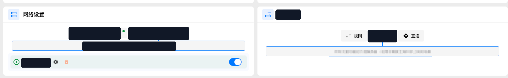
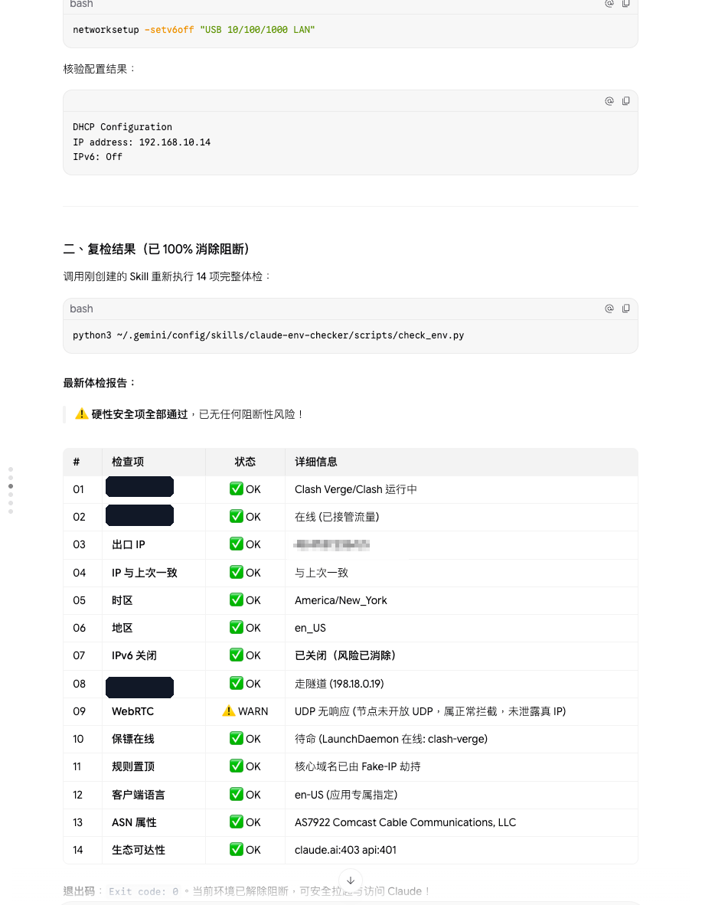
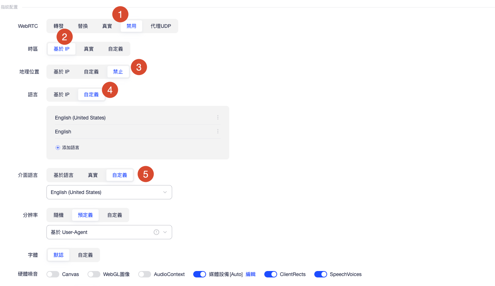
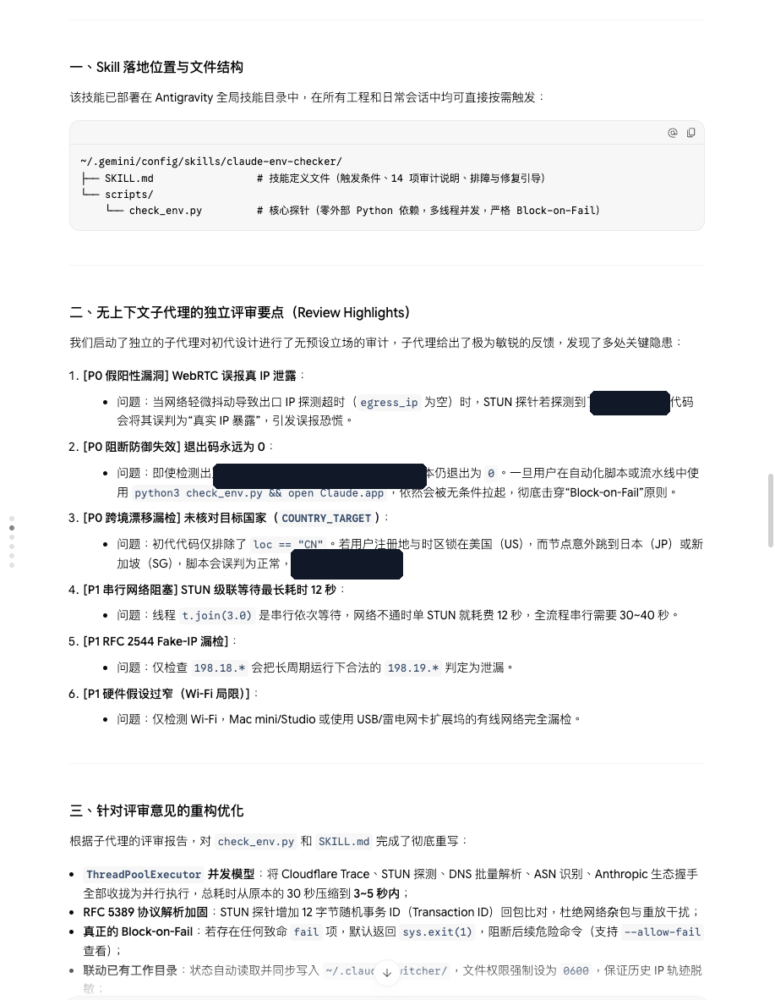

# Claude Code 使用全流程 SOP（IP 一致性版）

> 前置依赖：基于开源项目 [YOURSJEYO/claude-switcher](https://github.com/YOURSJEYO/claude-switcher) 衍生的 `claude-env-checker` 技能（14 项环境预检，Block-on-Fail）。
> 本机基线形态：**全局代理 + TUN（虚拟网卡）模式**，永久不变。
> 网页版：<https://yoursjeyo.github.io/claude-code-sop/>

## 流程总览

```
阶段一 准备 IP ───→ 阶段二 注册 ───→ 阶段三 付款/续费 ───→ 阶段四 日常使用
 干净住宅 IP        指纹浏览器         同一 IP 付款         Claude Code + 手机端
 买完先自检         OAuth 直登         IP 与注册地一致       每次启动前 14 项体检
```

全程只服务一件事：**出口 IP 一致**。平台一致性校验看的不是"有没有代理"，而是注册、收信、付款、日常对话、手机端这些行为像不像同一个地方的同一个人。

---

## 0. 四条总原则

| # | 原则 | 说明 |
|---|------|------|
| 1 | **一个账号，一条 IP** | 注册、收验证邮件、付款、日常对话、手机端，全部走同一条住宅出口 IP，全程不漂移 |
| 2 | **全局 + TUN，拒绝分流** | 全局模式保证没有进程直连；TUN（虚拟网卡）接管所有流量，包括不走系统代理的程序。规则模式下的意外直连、系统代理形态下的绕过，都是 IP 混用的来源 |
| 3 | **启动前必检** | 任何情况下，启动 Claude Code 之前先跑 `check_env.py`。存在任何致命 fail 项则退出码为 1，禁止带病启动（`--allow-fail` 只允许在"只查看"场景使用） |
| 4 | **浏览器层少干预** | 网络层（TUN）已保证 IP / DNS 一致，指纹浏览器里不要再叠加额外的"防泄露"类增强开关，保持指纹自然 |

---

## 1. 阶段一：准备干净住宅 IP

### 1.1 选购要求

- **住宅 ASN**：ISP 家宽段（如 AS7922 Comcast），避开机房段（AWS / GCP / OVH）和商业 VPN 段；
- **独享优先**：避开多人共用的公共节点——共用人越多，这个 IP 的历史越脏；
- **国家固定**：注册地 = 付款地 = 日常使用地（本 SOP 以美国 US 为例），节点不乱跳；
- **UDP 行为心里有数**：节点未开放 UDP 时，STUN 探测无响应属于正常拦截，WebRTC 检查项为 WARN 可接受（未泄露真实 IP 即可）。

### 1.2 买完先做两道自检

1. **网页检测**（DNS 泄露 / WebRTC 泄露 / IP 归属一次性看完）：
   <https://ippure.com/en/Browser-WebRTC-Leak-Detect>
2. **本机 14 项体检**：

   ```bash
   python3 ~/.gemini/config/skills/claude-env-checker/scripts/check_env.py
   ```

### 1.3 本机基线（一次配好，长期保持）

| 项 | 目标 | 做法 |
|----|------|------|
| 代理模式 | 全局 + TUN | 客户端里选「全局」+ 开启「虚拟网卡模式」（TUN） |
| IPv6 | 关闭 | `networksetup -setv6off "USB 10/100/1000 LAN"`（网卡名按实际改，Wi-Fi 则为 `"Wi-Fi"`） |
| 时区 | 与 IP 国家一致 | 如 `America/New_York` |
| 系统地区 / 语言 | 与 IP 国家一致 | 如 `en_US` / `en-US` |
| DNS | 走隧道 | TUN Fake-IP 接管，DNS 必须落在隧道内（`198.18.x.x` 属正常） |



### 1.4 14 项体检合格状态

| # | 检查项 | 合格状态 |
|---|--------|----------|
| 01 | 代理内核 | Clash Verge / Clash 运行中 |
| 02 | TUN 网卡 | 在线（已接管流量） |
| 03 | 出口 IP | 目标国家 IP |
| 04 | IP 与上次一致 | 一致（轨迹落盘 `~/.claude-switcher/`，权限 0660） |
| 05 | 时区 | 与 IP 国家一致（如 `America/New_York`） |
| 06 | 地区 | 如 `en_US` |
| 07 | IPv6 | 已关闭 |
| 08 | DNS 走隧道 | Fake-IP 劫持（`198.18.x.x`） |
| 09 | WebRTC | UDP 无响应 / 未泄露真实 IP（节点不开 UDP 时 WARN 可接受） |
| 10 | 代理保活 | LaunchDaemon 在线 |
| 11 | 规则置顶 | 核心域名已被 Fake-IP 劫持 |
| 12 | 客户端语言 | `en-US` |
| 13 | ASN 属性 | 住宅 ISP（如 AS7922 Comcast Cable Communications） |
| 14 | 生态可达 | `claude.ai:403` / `api:401`（可达即可，未带凭证时 401 是正常响应） |



---

## 2. 阶段二：注册（指纹浏览器）

### 2.1 Profile 定位

建一个**专用**指纹浏览器 profile，只做三件事：

1. Claude 网页对话；
2. Claude 注册；
3. Claude 邮箱收发（验证邮件）。

其他任何网站、任何用途都不要进这个 profile。多账号 = 多 profile，一一对应。

### 2.2 指纹配置

| 配置项 | 取值 | 说明 |
|--------|------|------|
| WebRTC | **禁用** | 指纹层彻底关掉 RTC，STUN 探测面为零 |
| 时区 | **基于 IP** | 时区跟随出口 IP，不自定义 |
| 地理位置 | **禁止** | 不暴露地理信息 |
| 语言 | **自定义** | `English (United States)` + `English` |
| 界面语言 | **自定义** | `English (United States)` |
| 分辨率 | **预定义** | 基于 User-Agent 推导，不随机 |
| 字体 | **默认** | — |
| 硬件噪音 | Canvas 关 · WebGL 图像 关 · AudioContext 关 · 媒体设备 Auto · ClientRects 开 · SpeechVoices 开 | — |

> **特别注意**：浏览器里若有「防 RTC 泄露」「防 DNS 泄露」这类**额外的**防泄露增强开关，**一律不开**。网络层已由 TUN 全局兜底、DNS 已走隧道，浏览器层再叠加只会制造异常指纹。



### 2.3 注册动作

1. 确认出口 IP 与历史一致（跑一次 `check_env.py`，或看面板）；
2. 在该 profile 内用 **Google / Apple ID 直接 OAuth 注册**，不要单独用邮箱注册；
3. 验证邮件在**同一个 profile** 里收——绝不切到系统浏览器、手机邮件 App 或任何其他环境收信；
4. 注册完成前不切节点。

### 2.4 关于"养号"

玄学养号（模拟浏览行为、隔几天再付款之类）见仁见智。本 SOP 不包含，本人也没有养。

---

## 3. 阶段三：付款与续费

- **渠道**：Google Play（Android 端应用内订阅）或 Apple ID 礼品卡（iOS 端应用内订阅）；网页端付款可用 Google Pay；
- **铁律：付款会话的出口 IP 必须与注册 IP 完全一致**——同一节点、同一出口，付款前后都不切；
- **配套一致**：用来付款的 Google / Apple 账号地区、礼品卡区服，与 IP 国家保持一致（US IP → US 区账号 → US 区礼品卡）；
- 续费同理：每次续费都在同一 IP 下完成。

---

## 4. 阶段四：手机端（Claude Code 登录 / 套餐管理）

1. **全局代理**：手机用 TUN 类客户端开**全局**模式，不要分应用分流；
2. **时区**：跟随 IP 国家；
3. **语言 / 地区**：系统语言、地区一并改掉，与 IP 国家一致；
4. 登录和套餐管理都在这个状态下进行。

---

## 5. 日常：每次启动 Claude Code

```
开代理（全局 + TUN）
        ↓
python3 check_env.py        ← 14 项体检，Exit 0 才放行
        ↓
启动 Claude Code
```

- 任何致命 fail → 按技能内的排障引导修复后重跑；**禁止**带 fail 强启（`--allow-fail` 仅限"只查看"场景）；
- 体检状态自动写入 `~/.claude-switcher/`，历史 IP 轨迹可追溯——发现 IP 漂移能第一时间定位。

---

## 6. 红线速查

| 场景 | 红线 |
|------|------|
| 换节点 | 不要立刻使用账号；先确认新 IP 的国家与 ASN，IP 与上次不一致时先停下 |
| 收验证邮件 | 绝不在指纹浏览器之外的环境收 |
| 付款 | IP 与注册 IP 不一致时不要付款 |
| 代理模式 | 分流 / 直连状态下不碰 Claude |
| IPv6 | 开着就是绕过 TUN 的暗门，必须关 |
| 体检 | `check_env.py` 有 fail 就不启动 Claude Code |

---

## 附录：claude-env-checker 技能

- 位置：`~/.gemini/config/skills/claude-env-checker/`（`SKILL.md` + `scripts/check_env.py`）；
- 特性：14 项体检、并发执行（3–5 秒）、RFC 5389 STUN 协议解析、真正的 Block-on-Fail（存在致命 fail 即 `exit 1`，支持 `--allow-fail` 仅查看）、状态写入 `~/.claude-switcher/`（权限 0660）、历史 IP 轨迹留痕；
- 设计经独立评审修复了 6 项隐患：假阳性 WebRTC 泄露误报、阻断失效（退出码恒 0）、跨境漂移漏检、串行等待过长、RFC 2544 Fake-IP 漏检、仅覆盖 Wi-Fi 的假设。


